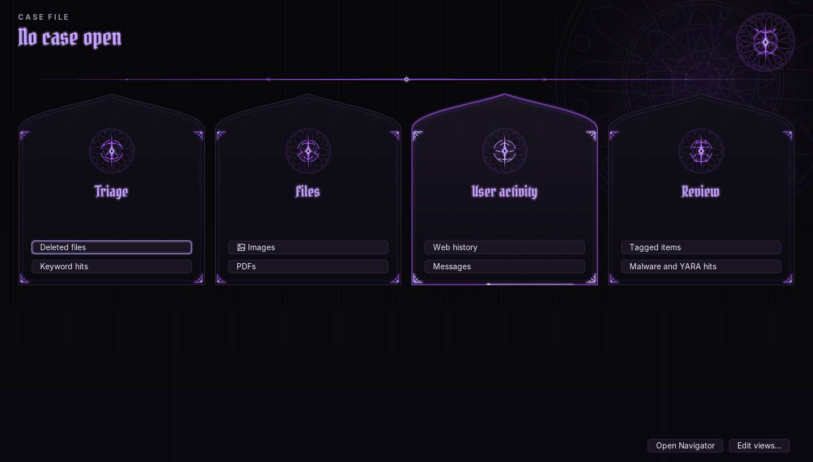
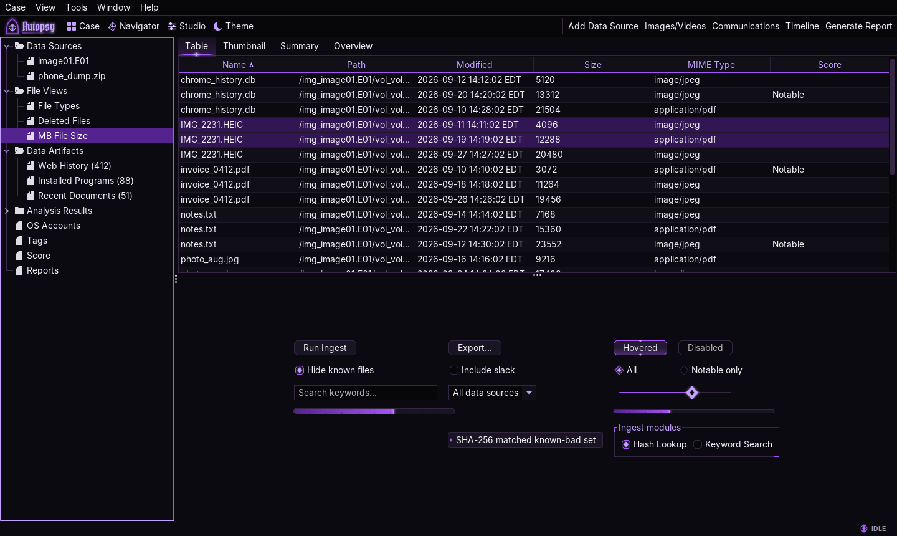
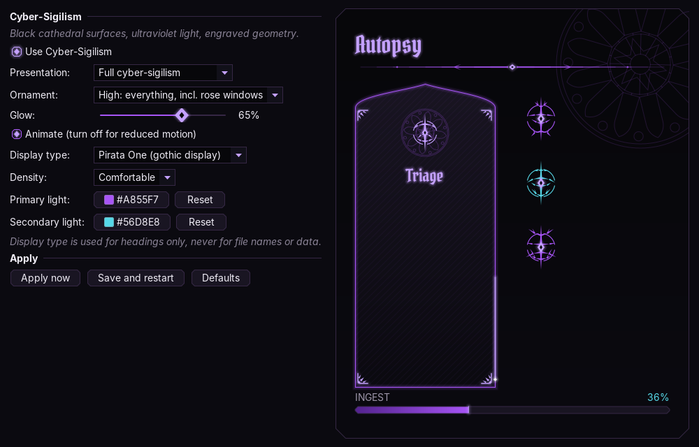
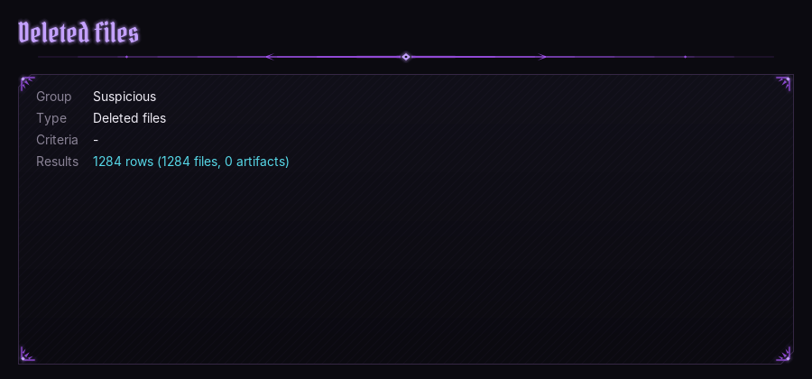

# Autopsy Modern UI

A NetBeans module for [Autopsy](https://www.autopsy.com/) 4.22.1 that switches it to FlatLaf and lets you rearrange most of the UI: theme colors, toolbars, menus, window layouts, and a side panel of saved searches.

FlatLaf 2.4 already ships with Autopsy's NetBeans platform, so nothing extra is bundled. The module doesn't touch Autopsy's install folder; everything it changes lives in your user config and can be reset.

| Cyber-Sigilism settings | Overview tab |
|---|---|
|  |  |

## Install

The quickest way is to download `com-modernui-autopsy.nbm` from the [Releases](../../releases) page and skip to step 3. To build it yourself:

You need NetBeans with a platform named `Autopsy_4.22.1` pointing at your Autopsy install (Tools > NetBeans Platforms).

1. Open this folder as a project.
2. Right-click the project > Create NBM. The module ends up in `build/com-modernui-autopsy.nbm`.
3. In Autopsy: Tools > Plugins > Downloaded > Add Plugins…, pick the .nbm, install.
4. Close Autopsy completely and start it again. The theme is set before any window is created, so it only takes effect on a fresh start.

## What's in it

**Cyber-Sigilism** is the default theme and the one with the most work in it: black cathedral surfaces, ultraviolet light and engraved geometry. Settings are in Studio > Cyber-Sigilism.

- Controls: buttons and tabs with clipped corners and lit edges, a violet progress gauge with notches, diamond check boxes, radio buttons and slider thumb, thorn sort arrows and chevron tree expanders, a primary-lit table header with diamond column joints, framed popup menus and tooltips, engraved group boxes. These are FlatLaf's own delegates with different painting, so keyboard handling, sizing and accessibility don't change.
- Plugin surfaces: the Case Workspace becomes a row of pointed-arch windows (each with its own sigil) under a slowly turning rose window; the Navigator and Overview tab get display-type headings and engraved frames; the toolbar gets an Autopsy wordmark; the status bar gets a sigil that turns while ingest runs.
- Settings: full or restrained presentation, ornament level, glow strength, animation on/off (reduced motion), display typeface (Pirata One, UnifrakturCook blackletter, Cinzel, or the UI font), density, and the primary and secondary light colors.
- Display type is only used for headings. File names, paths, tables and metadata stay in the UI font.
- Animation runs on one shared 20 fps timer, only while an animated element is on screen, and stops entirely when motion is off.

**Options page** (Tools > Options > Modern UI): theme, accent color, font, corner radius, row height, striped rows, tab style.

**Studio** (Tools > Modern UI Studio…, or Ctrl+Shift+U), with a Cyber-Sigilism tab (above) and these four:

- **Theme.** Pick a palette (Dracula, Nord, One Dark, Solarized, Gruvbox, Catppuccin, Monokai Pro, GitHub, Material Ocean, Forensic Navy, Professional Forensics, Cyber-Sigilism) or override any FlatLaf UI property by hand. Themes import/export as `.properties` files.
- **Toolbars & menus.** Hide, show and reorder any toolbar button or menu item. Icon-only buttons, small/large icons, optional replacement line icons for the common Autopsy commands. This uses the same `_hidden` mechanism Autopsy itself uses, and "Reset this group" undoes it.
- **Workspaces.** Named window layouts (NetBeans window roles). Switch to one, arrange panels, and it's saved.
- **Navigator.** Edit the saved views shown in the Navigator panel.

**Navigator** (left side, Window > Studio Navigator). Two tabs:

- *Case tree* is Autopsy's own directory tree, moved here so there's one left column instead of two. It's the same tree (same ExplorerManager), so selection, Back/Forward and Autopsy's "go to" actions work as normal. You can turn this off in Studio > Navigator.
- *Saved views* is a tree of your own searches, each with a count. Clicking one opens the results in Autopsy's normal result viewer, so tagging, content viewers and context menus all work. Ctrl+click opens a new tab. Comes with 34 starter views.

| View type | Parameter |
|---|---|
| File extensions | `jpg, png, heic` |
| MIME type | `image/%` |
| Artifact types | `TSK_WEB_HISTORY, TSK_WEB_DOWNLOAD` |
| Tagged items | tag name, or `*` |
| Modified recently | days |
| Large files | MB |
| Deleted files | - |
| Custom SQL | a `WHERE` clause on `tsk_files` |

All queries are read-only. Extension and MIME input is escaped.

**Case Workspace** (Window > Case Workspace) is a start page in the editor area with the open case's name and a few shortcuts into the saved views.

**Light/dark toggle**: View menu, the Workspace toolbar, or Ctrl+Shift+L.

## How the theme gets applied

NetBeans picks its look and feel once, from `--laf`, after every module's `ModuleInstall.validate()` and before it builds any windows. `Installer.validate()` sets that same value by reflection (`CLIOptions.uiClassName`) and registers the overrides with `FlatLaf.setGlobalExtraDefaults`, so Autopsy starts in FlatLaf with NetBeans' own FlatLaf window styling.

If that hook ever stops working, the theme is switched after startup instead. That path is less reliable: tables created under the Windows look keep header renderers that throw on paint, so `ThemeApplier` finds and rebuilds them.

Override order is palette, then the Options page, then Studio overrides.

The Cyber-Sigilism controls extend FlatLaf's UI delegates, which live in `com.formdev.flatlaf.ui`. NetBeans doesn't export that package to other modules, so those classes (`sigil.flat`) are loaded by `sigil.FlatBridge`, a small class loader whose parent is FlatLaf's own. For the same reason `nbproject/project.properties` puts the FlatLaf jar on the compile classpath with `cp.extra`.

## Troubleshooting

- Turn it off: Tools > Options > Modern UI > uncheck "Use the modern look", restart.
- Start Autopsy with `-J-Dmodernui.disable=true` to skip theming entirely.
- Broken toolbar or menu: Studio > Toolbars & menus > Reset this group.
- Broken window layout: Studio > Workspaces > Restore default layout.
- Dark themes: the hard-coded-color fix is experimental. If a panel looks worse with it, turn it off in Options.
- `messages.log` (Help > Open Log Folder) logs which path applied the theme, or why it didn't.

## Where settings live

- Simple settings: Autopsy's user preferences.
- `%APPDATA%\autopsy\config\ModernUI\`: theme overrides, navigator views, hidden items, original toolbar order.
- `%APPDATA%\autopsy\config\Windows2Local-<name>\`: workspace layouts.

## Source layout

| Package | |
|---|---|
| `com.modernui.autopsy` | `Installer`, `ThemeApplier`, settings, dark color fixer, config files, `layer.xml` |
| `.theme` | palettes, property overrides, Theme tab |
| `.ui` | toolbar/menu editing, toolbar display, icons |
| `.workspace` | workspaces, layout repair |
| `.navigator` | Navigator panel, view model, queries, result viewer glue |
| `.studio` | Studio window, Case Workspace, toolbar actions |
| `.sigil` | Cyber-Sigilism: palette and settings access, ornament library, control delegates, framed panels, status-bar element, Studio tab, bundled fonts |
| `.options` | Options page |

## Limits

Cyber-Sigilism can't reach: the main window frame itself (only its title-bar colors), NetBeans' own panel tab strips (Autopsy hides them anyway), the content viewers' internals (hex, text, media and HTML viewers draw their own content), Autopsy's ingest progress dialogs beyond their progress bars and buttons, and node icons in Autopsy's tree, which Autopsy supplies per node. Group boxes created before the theme is installed (rare) keep a plain border until restart.

This is a plugin, not a fork. It can restyle anything that goes through Swing/FlatLaf defaults and add its own panels, but it can't change how Autopsy's own result tables, content viewers or ingest panels lay out their contents. That would need changes to Autopsy itself.

The bundled display fonts are under the SIL Open Font License; see `src/com/modernui/autopsy/sigil/fonts/OFL.txt`.

The Rottweiler artwork is used for the window/taskbar icon and the Add Data Source button. Autopsy's splash screen comes from the launcher and can't be replaced from a module.

See [CHANGELOG.md](CHANGELOG.md) for version history.
